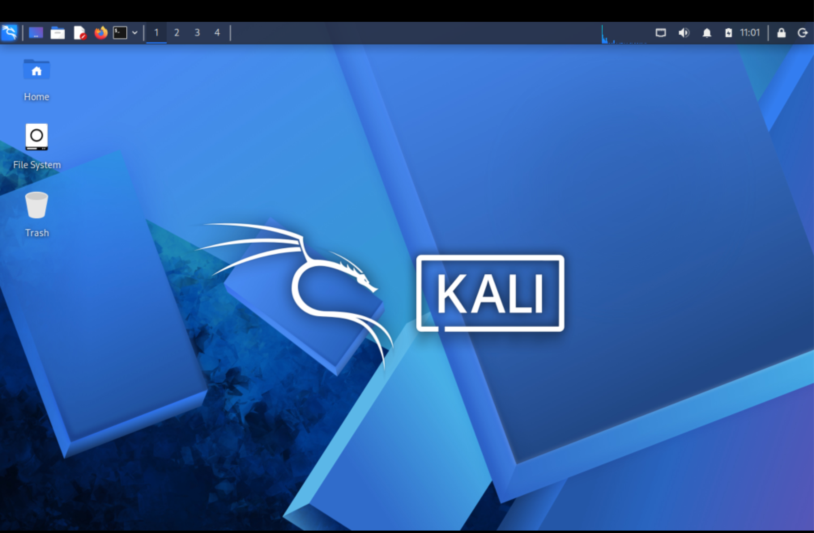
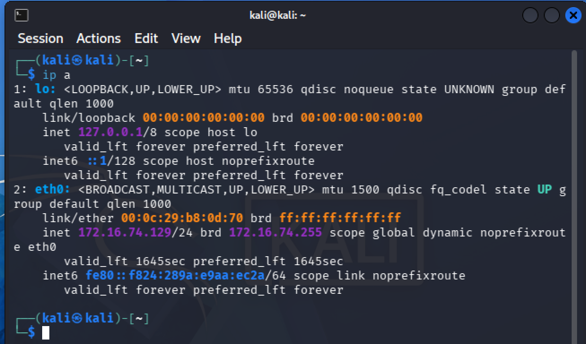
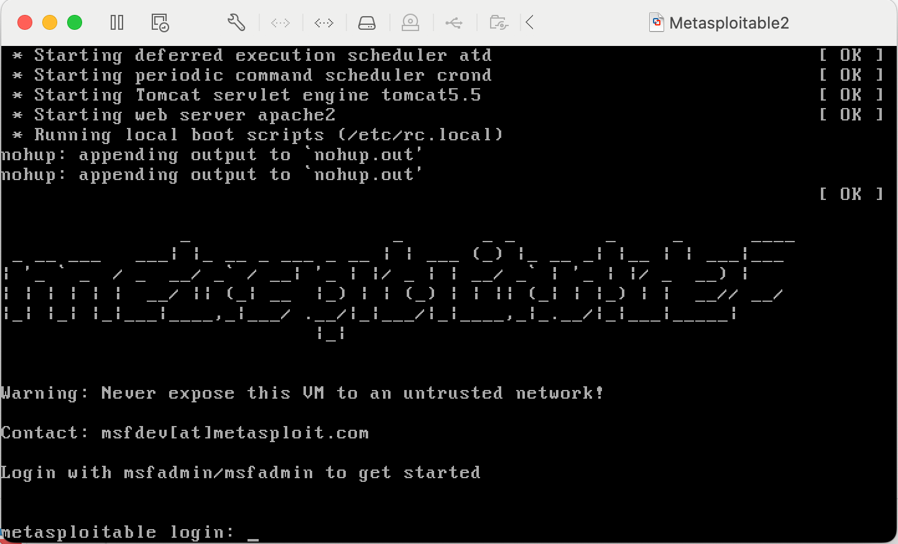
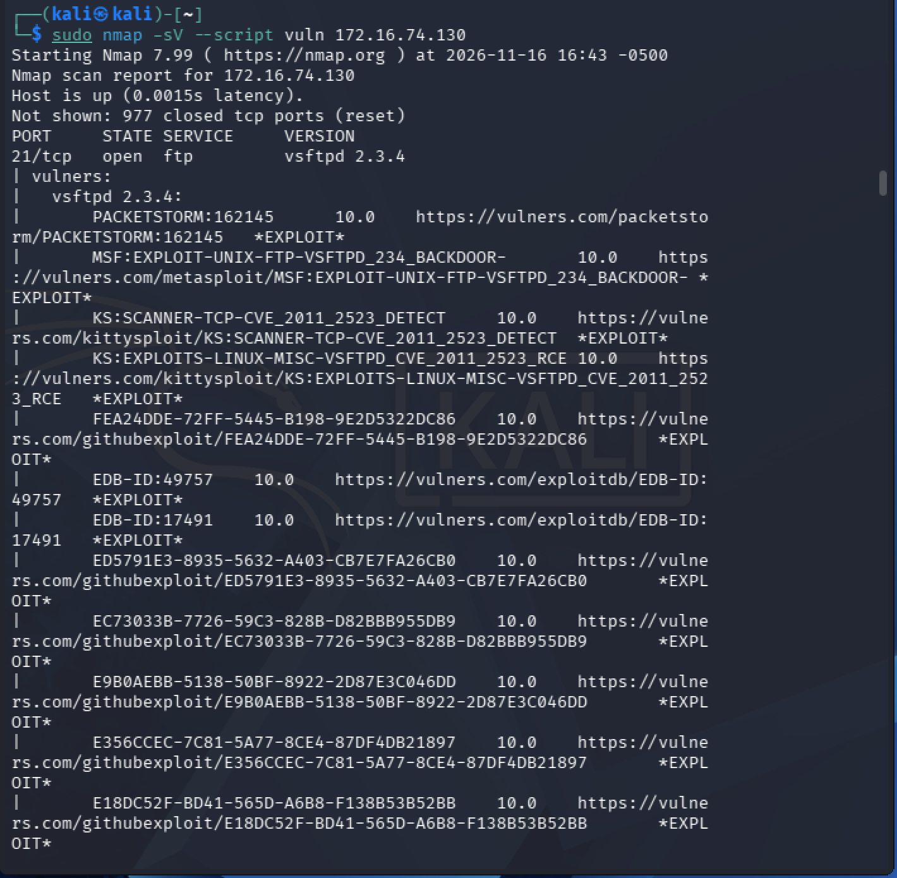

# Vulnerability Assessment Lab | Nmap & Metasploitable 2

# Project Description:

This is a beginner project to learn how to perform vulnerability assessments using Nmap and Metasploitable 2 in an isolated virtual lab. The goal is to set up the virtual machines, practice vulnerability scanning, review identified security weaknesses, and document findings and possible remediation.

## Tools Used
- Kali Linux
- Nmap
- Metasploitable 2
- VMware Fusion

## Lab Setup

**Screenshot 1:** Kali Linux environment.

**Screenshot 2:** Kali IP Address.

**Screenshot 3:** Metasploitable 2 environment.

**Screenshot 4:** Metasploitable 2 and Kali connectivity.

## Vulnerability Assessment

I used Nmap to scan the Metasploitable 2 machine and identify potential security weaknesses.

**Command used:**

`sudo nmap -sV --script vuln 172.16.74.130`

**Screenshot 5:** Nmap vulnerability scan results.

## Findings

Document three findings from the actual scan results.

**1. Vulnerability 1**
Finding 1: Outdated FTP service (vsftpd 2.3.4)

What Nmap found: An FTP service running vsftpd 2.3.4, a version associated with a known backdoor vulnerability.

What this means: The vulnerable service could potentially allow unauthorized access to the machine.

Possible remediation: Update to a secure version or disable FTP if it is not needed.

*Severity will be recorded when supported by the scan results or a verified vulnerability reference.*

## What I Learned

I learned how to configure an isolated virtual lab, connect a target machine, use Nmap to identify open ports and services, review potential security weaknesses, and document findings and possible remediation recommendations.

## Learning Resources

`MyDFIR Vulnerability Assessment Lab Tutorial

Used as a learning guide for setting up the virtual lab
and understanding the vulnerability scanning process.`

`The virtual lab configuration, scan results, analysis,
screenshots, and documentation are based on my own
hands-on practice.`

<!--
**2. Vulnerability 2**
- Finding:
- Severity:
- Possible remediation:

**3. Vulnerability 3**
- Finding:
- Severity:
- Possible remediation:
__________________________

-->

