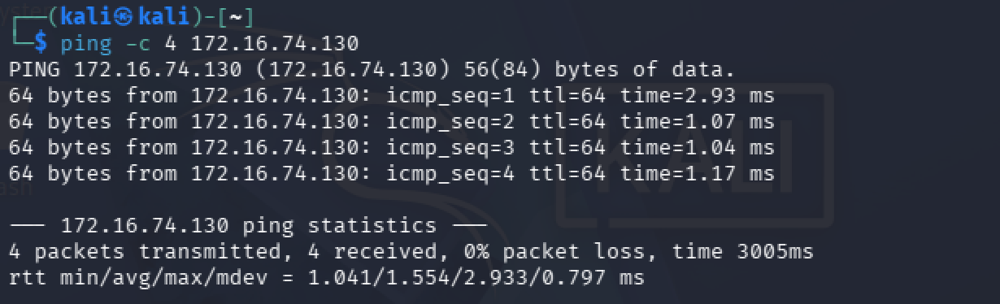

# Vulnerability Assessment Lab | Nmap & Metasploitable 2

# Project Description:

This is a beginner project to learn how to perform vulnerability assessments using Nmap and Metasploitable 2 in an isolated virtual lab. The goal is to set up the virtual machines, practice vulnerability scanning, review identified security weaknesses, and document findings and possible remediation.

## Tools Used
- Kali Linux
- Nmap
- Metasploitable 2
- VMware Fusion

## Lab Setup

**Screenshot 1:** Kali Linux environment.

**Screenshot 2:** Metasploitable 2 environment.

**Screenshot 3:** Metasploitable 2 and network connectivity.

<!--

## Vulnerability Assessment

I used Nmap to scan the Metasploitable 2 machine and identify potential security weaknesses.

**Command used:**

`sudo nmap -sV --script vuln 172.16.74.130`

**Screenshot 4:** Nmap vulnerability scan results.

## Findings

Document three findings from the actual scan results.

**1. Vulnerability 1**
Finding 1: Outdated FTP service (vsftpd 2.3.4)

What Nmap found: An FTP service running vsftpd 2.3.4, a version associated with a known backdoor vulnerability.

What this means: The vulnerable service could potentially allow unauthorized access to the machine.

Possible remediation: Update to a secure version or disable FTP if it is not needed.

**2. Vulnerability 2**
- Finding:
- Severity:
- Possible remediation:

**3. Vulnerability 3**
- Finding:
- Severity:
- Possible remediation:

*Severity will be recorded when supported by the scan results or a verified vulnerability reference.*

## What I Learned

I learned how to configure an isolated virtual lab, connect a target machine, use Nmap to identify open ports and services, review potential security weaknesses, and document findings and possible remediation recommendations.

__________________________

-->

<!--

Phase 1: Environment Setup

Objective: Prepare the virtual machines for the lab.

Activities:

Set up Metasploitable 2 in VMware Fusion.

Prepare Ubuntu for Greenbone OpenVAS.

Configure the virtual network.

Results:

Environment setup is in progress. Network connectivity between the virtual machines has not yet been verified.

Screenshots:

Screenshots of the VMware Fusion configuration will be added as the lab progresses.

-->

<!--
## Next Steps

1. Complete the virtual lab environment setup.
   - Set up Metasploitable 2.
   - Prepare Ubuntu and Greenbone OpenVAS.
   - Configure the isolated virtual network.
   - Verify connectivity between the virtual machines.

2. Begin the vulnerability assessment.
   - Run a vulnerability scan.
   - Review the scan findings.
   - Understand the identified security weaknesses.
   - Document findings and possible remediation recommendations.

Project Overview

This project involved setting up a vulnerability assessment lab using Kali Linux, OpenVAS, and Metasploitable 2. The objective was to identify security vulnerabilities on a deliberately vulnerable target machine and understand their potential risks.

Tools Used
- Kali Linux
- OpenVAS / Greenbone
- Metasploitable 2
- VMware Fusion
Lab Setup

[Screenshot 1: Kali Linux and OpenVAS]

[Screenshot 2: Metasploitable 2 connectivity]

Vulnerability Assessment Results

[Screenshot 3: Completed vulnerability scan]

Findings
1. Vulnerability 1: Description and severity.
2. Vulnerability 2: Description and severity.
3. Vulnerability 3: Description and severity.
Remediation Recommendations

Brief recommendations for addressing each finding.

What I Learned

I learned how to configure a vulnerability assessment environment, connect a target machine, use OpenVAS to identify vulnerabilities, and interpret scan findings.

   ## Learning Resources

MyDFIR OpenVAS Vulnerability Assessment Lab Tutorial

Used as a learning guide for setting up the virtual lab
and understanding the vulnerability scanning process.

The virtual lab configuration, scan results, analysis,
screenshots, and documentation are based on my own
hands-on practice.
-->
